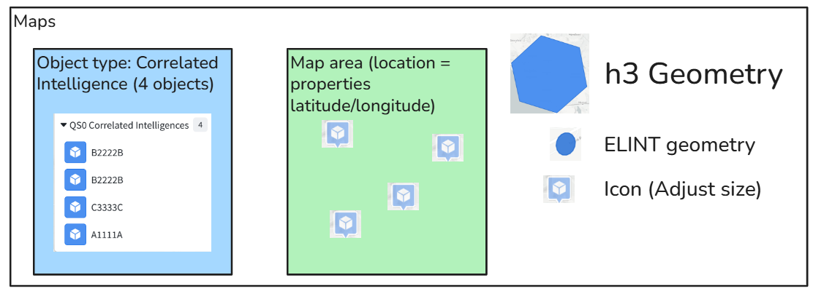
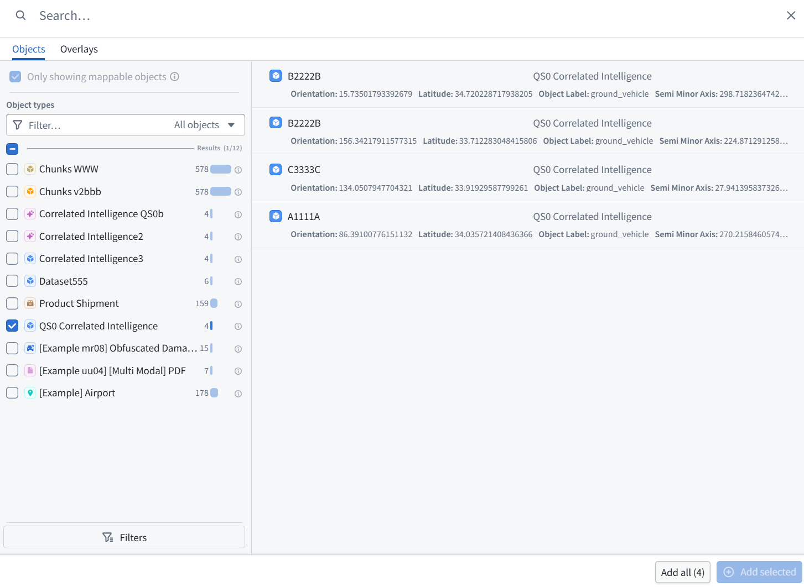
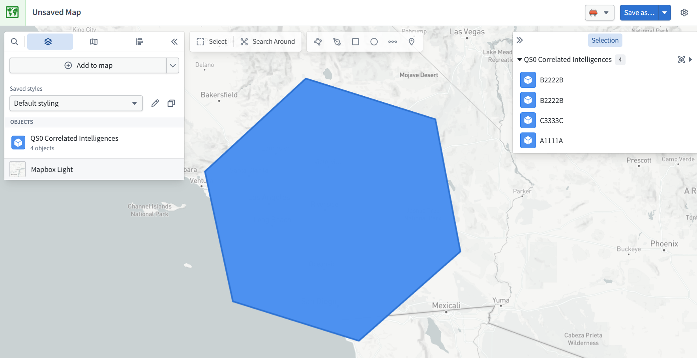
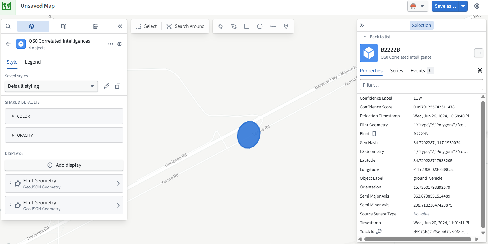
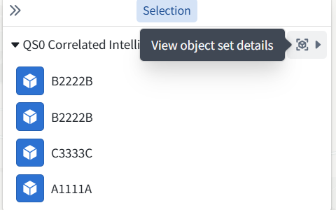
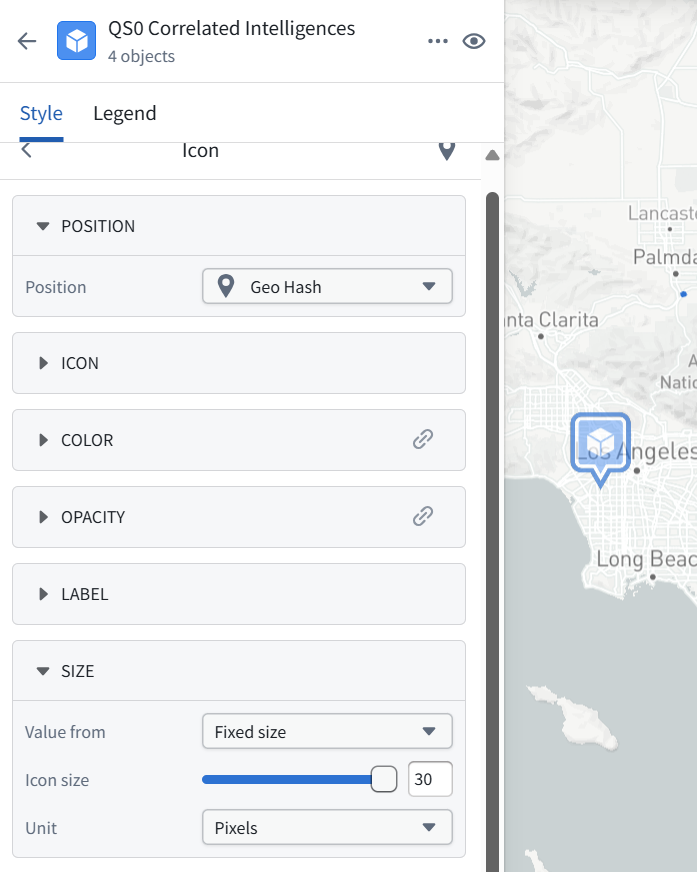
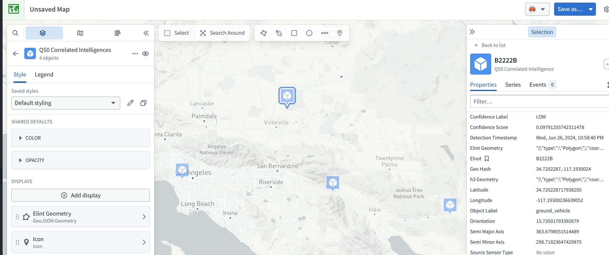
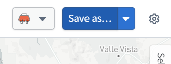
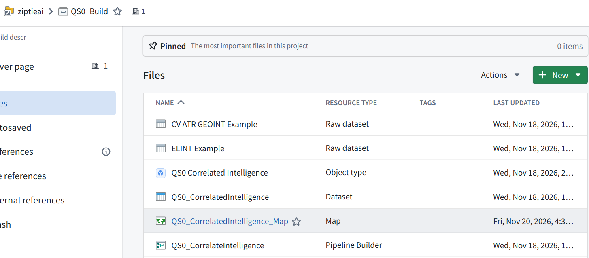
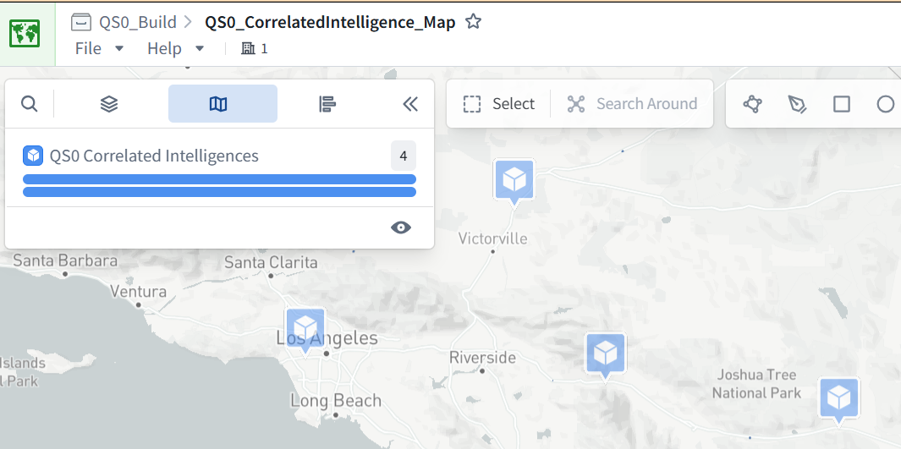

<!-- 6 Display in Maps -->
[← 5 Create object type](/pal_qs0_5_objectype/) / [↑ 3.2 Foundry QS0](/pal_qs0/) / [→ 7 Create UI (in project QS0b)](/pal_qs0_7_ui/)

_Converted from DOCX by GPT on 2026-11-26 08:59:25 EST_

<br>



**TOC**
- [6.1 Create map; display Objects of type QS0 Correlated Intelligence](#section-1)
- [6.2 Switch to ELINT Geometry (smaller shape)](#section-2)
- [6.3 To fit all four objects on screen:](#section-3)
- [6.4 Change to icon and change size](#section-4)
- [6.5 Save the map](#section-5)

<br>

<a id="section-1"></a>
### **6.1 Create map; display Objects of type QS0 Correlated Intelligence**

1\. Open **Maps** from Foundry’s **Applications** menu.

2\. Start a **new map**.

3\. Click **Add to map**.

4\. In the **Object types** filter, search for: QS0 Correlated Intelligence

5\. Select that object type’s checkbox.

6\. Click **Add all (4)**.



7\. Show the resulting map. If the object type is absent or shows zero objects, let me know—indexing may still be finishing.

**FDE: The icon’s position represents the object’s longitude and latitude**, through its configured geographic property.

In your pipeline:

**Latitude + Longitude → GeoPoint → Ontology GeoPoint property → map icon position**

The map uses that configured geographic property—not simply any two properties named Latitude and Longitude.



<br>

<a id="section-2"></a>
### **6.2 Switch to ELINT Geometry (smaller shape)**

**FDE: Geometry describes a geographic shape.** For an area, its boundary is defined by coordinate pairs.

In your pipeline:

- **H3 geometry:** the boundary of the H3 grid cell.

- **ELINT geometry:** the observation’s geographic shape, which may represent an uncertainty area.

- **GeoPoint:** a single location, not an area.

The map can draw the geometry as an outline or filled area when that property is configured for display.

Success—all four objects are on the map. The large hexagon appears to be **h3 Geometry**, the coarse H3 cell used for candidate matching—not the smaller **Elint Geometry** shown in the installed example.

1\. Click outside the popup without changing the name.

2\. Then click the **QS0 Correlated Intelligences object-layer row** below it—the row showing **4 objects**—and show the settings that open.


3\. Click on h3 Geometry.

**We can change this display directly—no deletion is needed.**

4\. At the top of the panel, under **GEOMETRY**:

  - Open the dropdown currently set to **h3 Geometry**.

  - Select **Elint Geometry**.


This switches the display from the large H3 cell to the smaller ELINT shapes. Leave the other settings unchanged.

5\. Then show the map. If you already added a separate Elint Geometry display, we’ll remove the redundant display afterward.



**The map now displays the smaller ELINT geometry correctly.**

- There are **two identical Elint Geometry displays** in the left panel because we added one and changed the original H3 display to the same geometry.

- The data and pipeline need no changes.


**FDE: You selected the other object titled B2222B.** The two objects have:

- The **same title:** B2222B

- **Different Track Ids**

- **Different coordinates and ELINT shapes**

The duplicate **Elint Geometry display cards** are a separate issue: each display draws the layer’s objects. They do **not** create those two locations. **Both locations are legitimate results, not duplicate objects caused by Maps.**

<br>

<a id="section-3"></a>
### **6.3 To fit all four objects on screen:**

1\. Click **Back to list** at the top of the **right-hand Selection panel**.

2\. Beside the group heading **QS0 Correlated Intelligences — 4**, click the **target/frame icon** to zoom to the group. That should fit all four locations into the map view.



**This is the right panel—but the tooltip says “View object set details,” not zoom. I misidentified that icon.**

The simplest way now:

3\. Move your mouse over the **map itself**.

4\. Scroll the mouse wheel **down** to zoom out.

The four locations are spread across Southern California. Their ELINT shapes are small, so they may become hard to see when zoomed out. To make all four visible at that scale, we should add **Geo Hash → Icon** as another display. That gives each location a marker while retaining the ELINT shapes when zoomed in.

<br>

<a id="section-4"></a>
### **6.4 Change to icon and change size**

1\. Open the **QS0 Correlated Intelligences** layer in the left panel.

2\. Under **Displays**, click **Geo Hash — Icon**.


3\. Click on **Icon.**


4\. Modify the size.





<br>

<a id="section-5"></a>
### **6.5 Save the map**

**Yes—save the map in QS0_Build (project), alongside those resources.**

You’re viewing the **project’s top-level file list**, not a separate folder. No additional folder is required.

Suggested map name:

```
QS0_CorrelatedIntelligence_Map
```





CTRL-LEFT CLICK on the link.

**The saved map opens.**

The breadcrumb confirms:

**QS0_Build (project) → QS0_CorrelatedIntelligence_Map (saved map)**

It displays **4 QS0 Correlated Intelligence objects**. You can now reopen this map from the project’s file list rather than recreate it.


