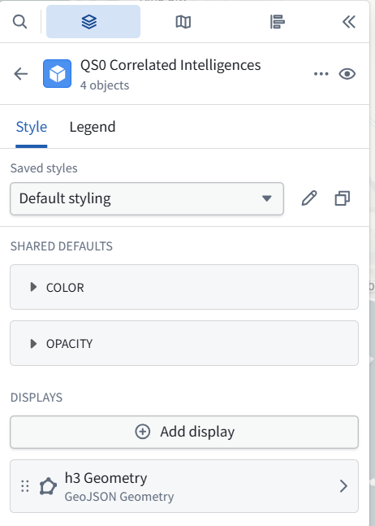
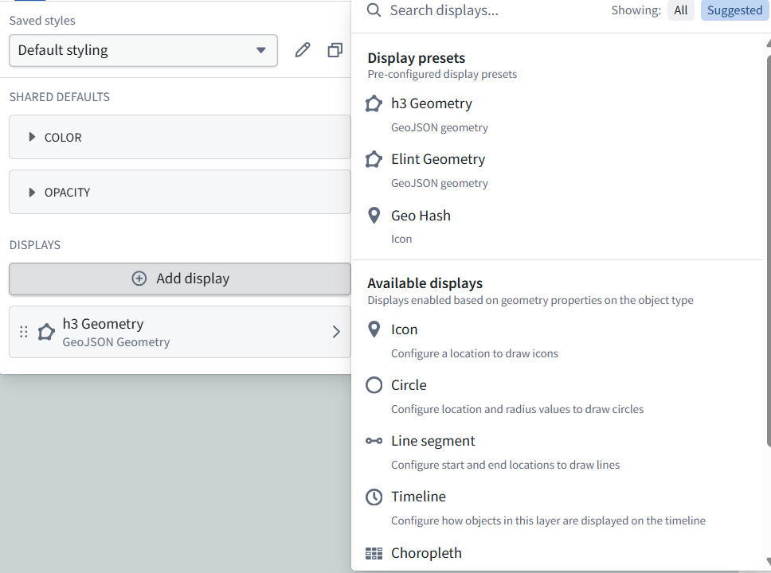
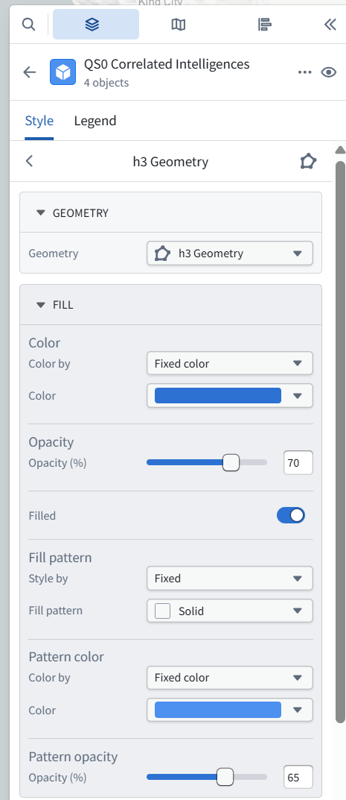
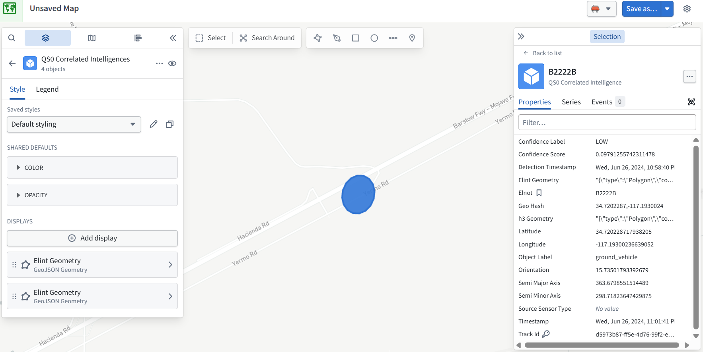
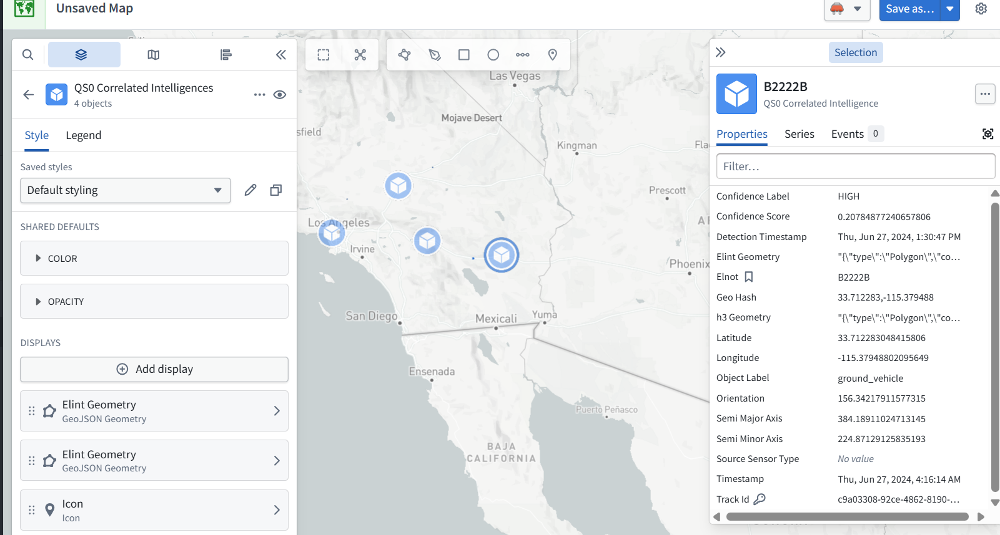

 

[← QS0](/pal_qs0/)

_Converted 2026-11-19 04:35 PM EST_

 

1\. Open **Maps** from Foundry’s **Applications** menu.

2\. Start a **new map**.

3\. Click **Add to map**.

4\. In the **Object types** filter, search for: QS0 Correlated Intelligence

5\. Select that object type’s checkbox.

6\. Click **Add all (4)**.

7\. Show the resulting map. If the object type is absent or shows zero objects, let me know—indexing may still be finishing.

Success—all four objects are on the map. The large hexagon appears to be **h3 Geometry**, the coarse H3 cell used for candidate matching—not the smaller **Elint Geometry** shown in the installed example.

8\. To adjust the display:

- Click the **pencil beside Default styling** in the left panel.

- Show the styling settings.

We’ll select **Elint Geometry** for the smaller observation shapes, or **Geo Hash** for point locations. **No pipeline rebuild is needed.**

**That pencil renames the saved style—it does not edit the geometry. My mistake.**

9\. Click outside the popup without changing the name.

10\. Then click the **QS0 Correlated Intelligences object-layer row** below it—the row showing **4 objects**—and show the settings that open.

**We can change this display directly—no deletion is needed.**

11\. At the top of the panel, under **GEOMETRY**:

- Open the dropdown currently set to **h3 Geometry**.

- Select **Elint Geometry**.

This switches the display from the large H3 cell to the smaller ELINT shapes. Leave the other settings unchanged.

12\. Then show the map. If you already added a separate Elint Geometry display, we’ll remove the redundant display afterward.

**The map now displays the smaller ELINT geometry correctly.**

There are **two identical Elint Geometry displays** in the left panel because we added one and changed the original H3 display to the same geometry.

Hover over the **lower Elint Geometry card** and check for a **×, trash can, or menu**. If one appears, show it before clicking—we want to remove **only the redundant display**, not the object layer.

The data and pipeline need no changes.

**Yes—you selected the other object titled B2222B.** The two objects have:

- The **same title:** B2222B

- **Different Track Ids**

- **Different coordinates and ELINT shapes**

The duplicate **Elint Geometry display cards** are a separate issue: each display draws the layer’s objects. They do **not** create those two locations.

**Both locations are legitimate results, not duplicate objects caused by Maps.**

To fit **all four objects** on screen:

1\. Click **Back to list** at the top of the **right-hand Selection panel**.

2\. Beside the group heading **QS0 Correlated Intelligences — 4**, click the **target/frame icon** to zoom to the group.

That should fit all four locations into the map view.

**This is the right panel—but the tooltip says “View object set details,” not zoom. I misidentified that icon.**

The simplest way now:

1\. Move your mouse over the **map itself**.

2\. Scroll the mouse wheel **down** to zoom out.

The four locations are spread across Southern California. Their ELINT shapes are small, so they may become hard to see when zoomed out.

To make all four visible at that scale, we should add **Geo Hash → Icon** as another display. That gives each location a marker while retaining the ELINT shapes when zoomed in.

To enlarge the markers:

1\. Open the **QS0 Correlated Intelligences** layer in the left panel.

2\. Under **Displays**, click **Geo Hash — Icon**.

3\. Look for **Size** or **Icon size** in its settings.

Show that panel if you don’t see the size control. **Choose the Icon display—not either Elint Geometry display**, which controls polygon shapes.

