<!-- 7 Create UI -->
[← 6 Display in Maps](/pal_qs0_6_maps/) / [↑ 3.2 Foundry QS0](/pal_qs0/) / [→ 8 HN algorithm description](/pal_qs0_8_algorithm/)


_Converted 2026-11-19 04:40 PM EST_

<br>

**TOC**
- [7.0 For this tutorial, I would recommend a small Workshop app with a Map widget.](#section-7-0-for-this-tutorial-i-would-recommend-a-small-workshop-app-with-a-map-widget)
- [7.1 Create the Workshop module](#section-7-1-create-the-workshop-module)
- [7.2 Start with the results table](#section-7-2-start-with-the-results-table)
- [7.3 Add the map](#section-7-3-add-the-map)
- [7.4 Save and publish this version](#section-7-4-save-and-publish-this-version)

<br>

<a id="section-7-0-for-this-tutorial-i-would-recommend-a-small-workshop-app-with-a-map-widget"></a>
### **7.0 For this tutorial, I would recommend a small Workshop app with a Map widget.**

Not because it eliminates configuration, but because we can configure it once and give the reader a focused interface.

| Option | Best fit |
| --- | --- |
| Maps—the app we just used | Open-ended geospatial investigation, with many display controls |
| Workshop + Map widget | A purpose-built screen: results table, map, and selected-object details |
| Quiver + Map card | Exploring objects through maps alongside analytical charts |

Foundry documents Workshop’s Map widget and Quiver’s Map card as alternatives for visualizing Ontology data.

Use geospatial data in the Ontology / How to visualize, explore, and publish geospatial data

**My recommendation**

**Keep today’s Maps result as the completed exercise.** Save it as **QS0_ResultMap** in **QS0_Build**.

Then add a **North extension** using Workshop:

- **Results table:** four needles.

- **Map:** clearly sized point markers and optional ELINT shapes.

- **Details:** properties of the selected needle.

That would also demonstrate your NES idea: **the same Equator objects, presented through a different North application.**

North extension: Display the needles in Workshop

What we will build: A small Workshop UI using the **four objects we already created**:

- **Results table:** lists the detected needles.

- **Map:** displays their locations.

- **Details:** shows the selected object’s properties.

No new pipeline or dataset is needed.

<br>

<a id="section-7-1-create-the-workshop-module"></a>
### **7.1 Create the Workshop module**

1\. Open **QS0_Build (project)**.

2\. Click **New → Workshop**. If Workshop is not listed, open it from **Applications**.

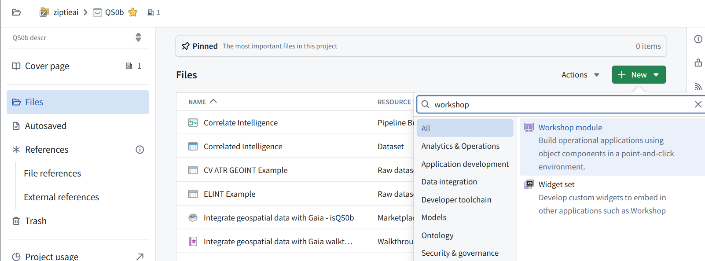

3\. Create a **Blank module** named:

```

QS0_NeedleViewer

```

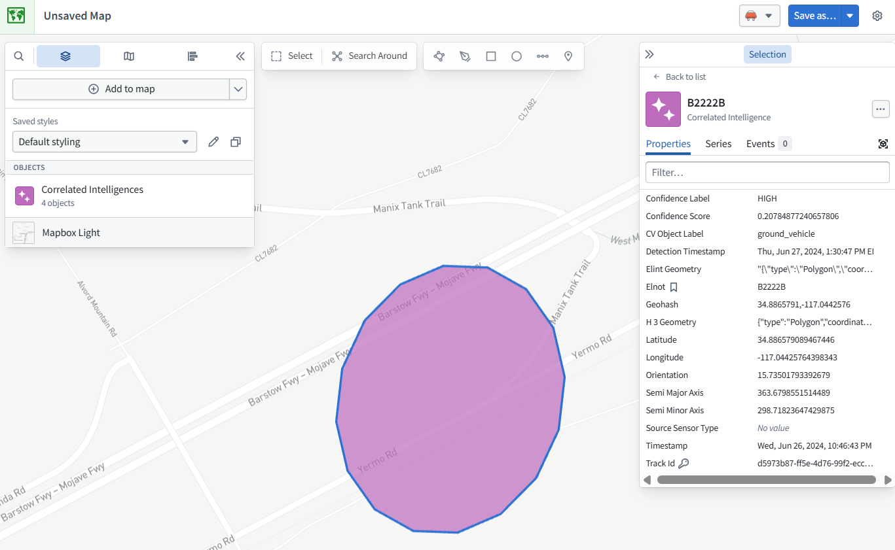

4\. Save it in **QS0_Build**.

<br>

<a id="section-7-2-start-with-the-results-table"></a>
### **7.2 Start with the results table**

1\. Add an **Object table** widget.

2\. Set its input to all objects of **QS0 Correlated Intelligence**. Do **not** choose **Correlated Intelligence QS0b** or another earlier installation.

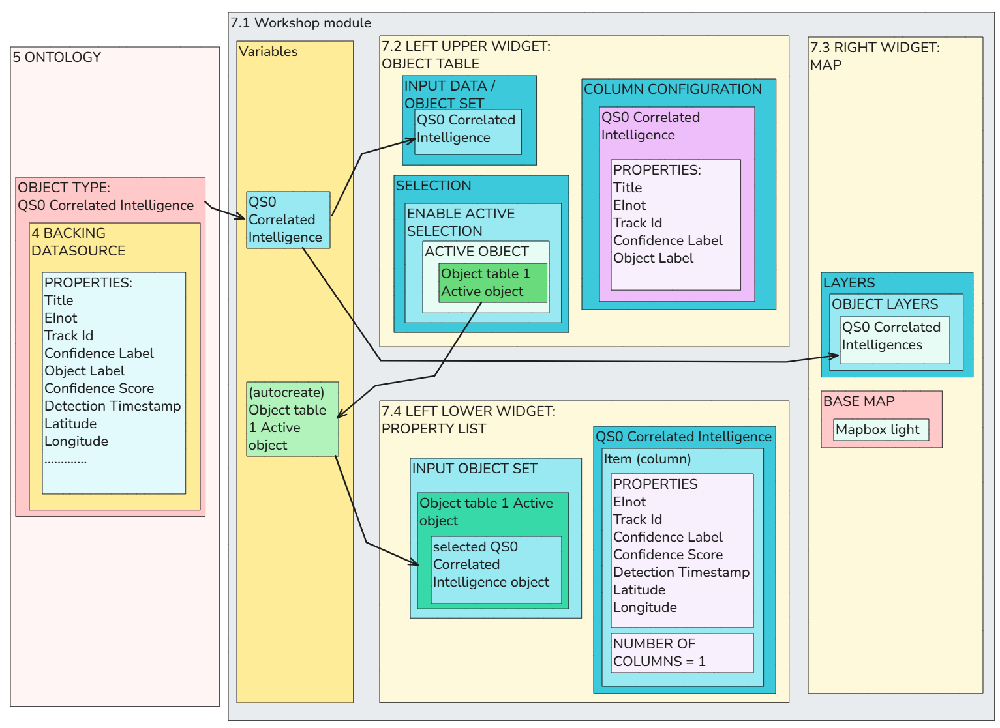

3\. Display:

- **Elnot**

- **Track Id**

- **Confidence Label**

- **Object Label**

4\. Enable **single-object active selection**.

**Checkpoint:** the table should contain **four objects**, including two titled **B2222B** with different Track Ids.

**Stop there and show the editor when you return.** Next we’ll add the Map widget using **Geo Hash** for point locations, then connect table selection to the details display.

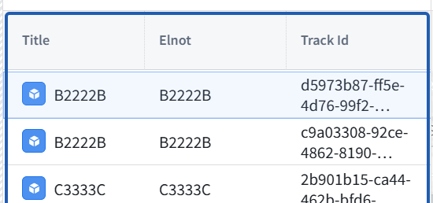

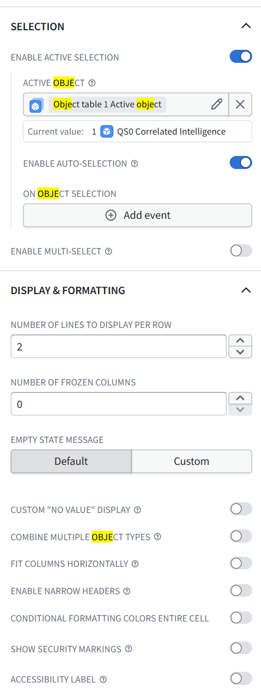

Already configured correctly—no changes needed:

- **Active selection:** ON

- **Auto-selection:** ON

- **Multi-select:** OFF

**Object table 1 Active object** holds the selected row’s object. We’ll use it for the details panel later; leave **On object selection → Add event** empty.

<br>

<a id="section-7-3-add-the-map"></a>
### **7.3 Add the map**

1\. Click the empty **right-hand Section**, add a **Map** widget, and show its **Widget setup** panel. The map will display **all four objects**, not just the selected row.

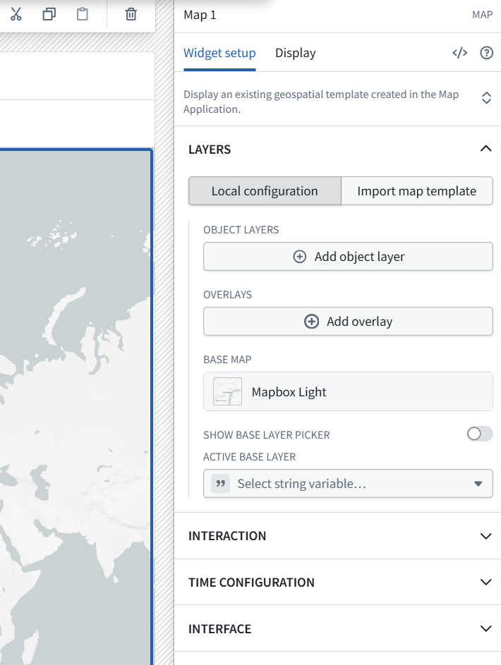

**The Map widget is ready.** Keep **Local configuration** selected—we’ll configure this map directly rather than import the earlier map.

2\. Click **Add object layer**.

3\. For its **Object set**, select the existing **QS0 Correlated Intelligence** variable—the same one feeding the table, with **4 objects**. **Do not select Object table 1 Active object**, which contains only the selected object.

4\. Show the layer settings that open. We’ll use **Geo Hash** for the point locations.

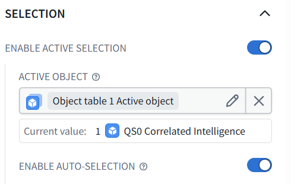

**The layer correctly contains all four objects.** It has automatically chosen the large **H3 geometry**, as Maps did earlier.

5\. In the right-hand configuration panel:

- Expand **DISPLAYS**, near the bottom.

- Show the display settings.

We’ll configure **Geo Hash as point markers** and remove the H3 polygon display. Leave the **Selection** settings unchanged for now.

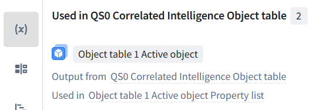

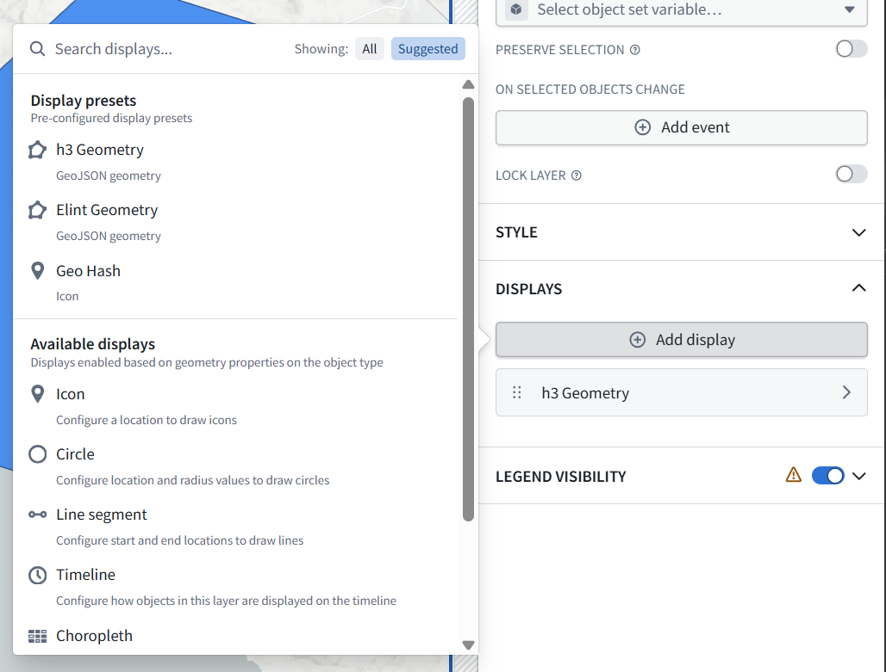

6\. Select **Geo Hash** under **Display presets**—the option labeled **Icon**.

7\. After it is added, hover over the existing **h3 Geometry** display row.

If a remove control appears, show it before clicking. We want to remove **only the H3 display**, keeping the object layer and the new point markers.

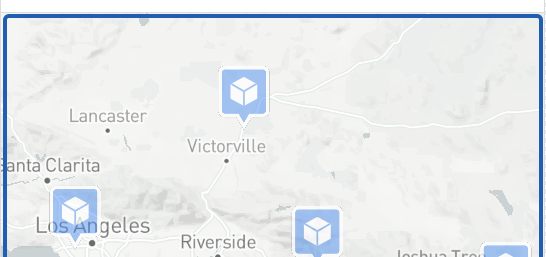

8\. Click the **trash-can icon on the h3 Geometry row**.

9\. This removes **only that display configuration**—not the property, objects, or data.

10\. Keep the **Icon** row. The large blue hexagon should disappear, leaving the four point markers.

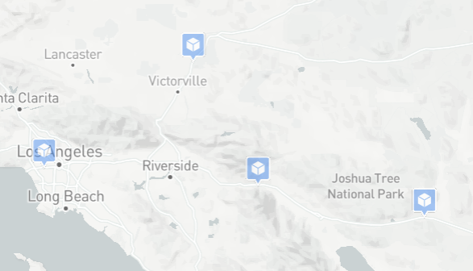

**Correct—all four point markers are visible, with the H3 polygon removed.**

**Next: show the selected needle’s details**

11\. Add a **Property list** widget **below the results table** in the left section.

12\. Set **Input object set** to **Object table 1 Active object**—the selected table row.

13\. Add these properties:

  - **Elnot**

  - **Track Id**

  - **Confidence Label**

  - **Confidence Score**

  - **Detection Timestamp**

  - **Latitude**

  - **Longitude**

14\. Click different table rows and verify that the details update. **The map should continue displaying all four objects.** Show the resulting layout.

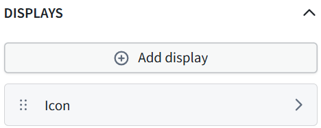

**The details panel works:** switching between the two **B2222B** rows changes the Track Id, confidence, timestamp, and coordinates.

**Make the details readable**

15\. Select the **Property list** widget—the left-tree entry beginning **Object table 1 Active object…**.

16\. Under **Widget setup → Item**, change **Number of columns** from **2** to **1**. This gives labels and values more space.

17\. You can also rename that widget **Needle details** in the Layout tree.

18\. Then **Save and publish → View** and verify:

- All **four markers** remain on the map.

- Selecting a table row updates **Needle details**.

Map-marker highlighting is not linked to table selection yet; that can be a separate extension.

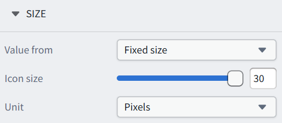

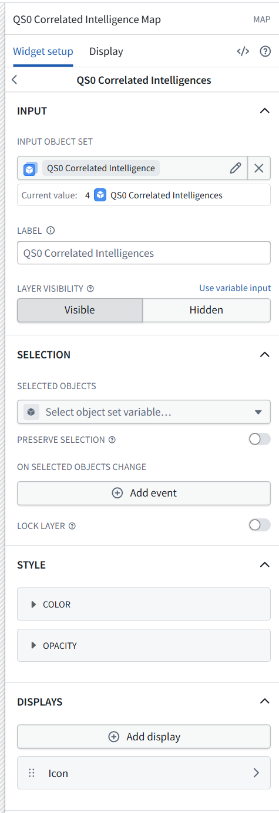

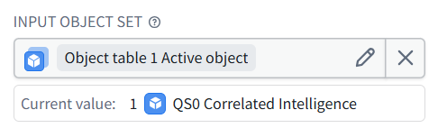

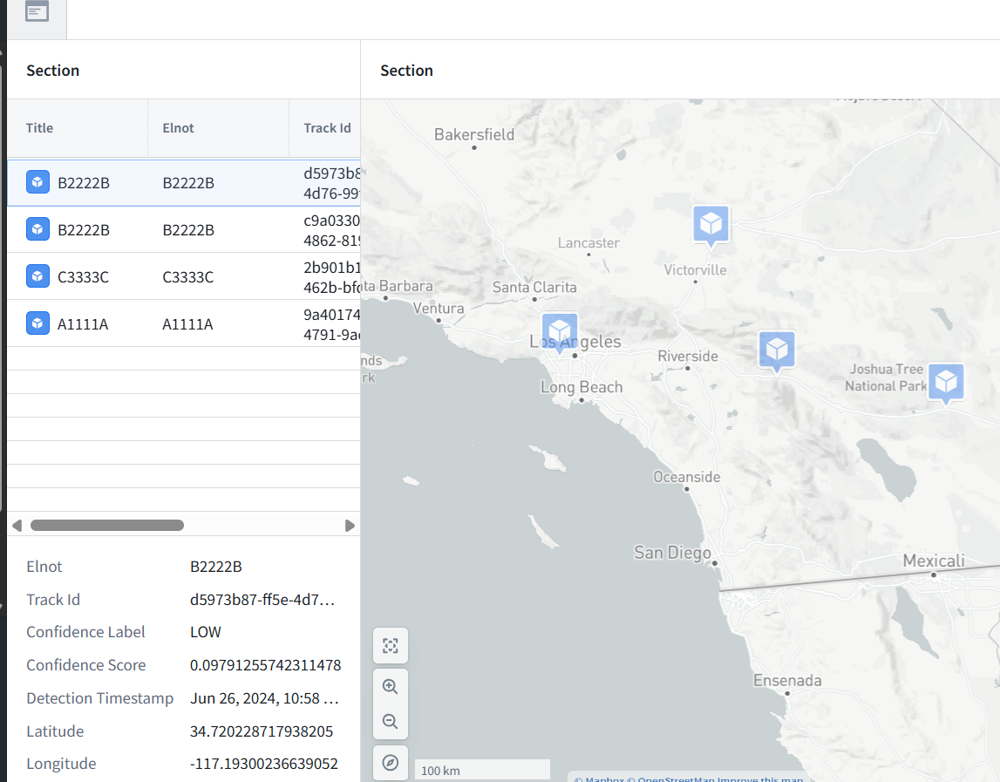

**All four markers are visible now.** The configuration is correct:

- **Layer input:** all four objects

- **Icon position:** Geo Hash

- **Icon size:** 30 pixels

- **Details input:** the selected table row

The earlier blank view was a **viewport/zoom issue**, not missing data.

<br>

<a id="section-7-4-save-and-publish-this-version"></a>
### **7.4 Save and publish this version**

Then reopen **View** to check whether it retains this useful regional extent. If it resets to Los Angeles again, we’ll configure the map’s initial viewport explicitly.

question: the left table is too narrow .... how to make it wider?

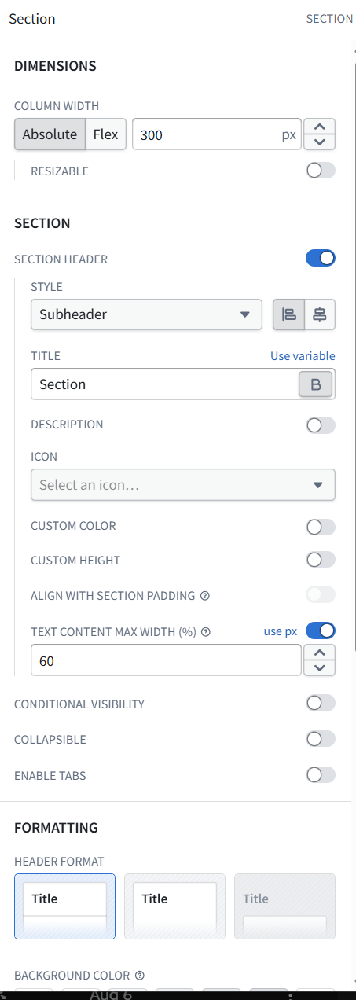

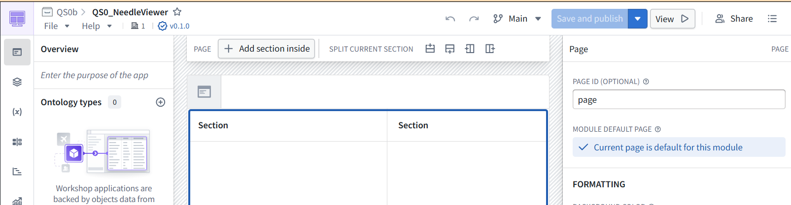

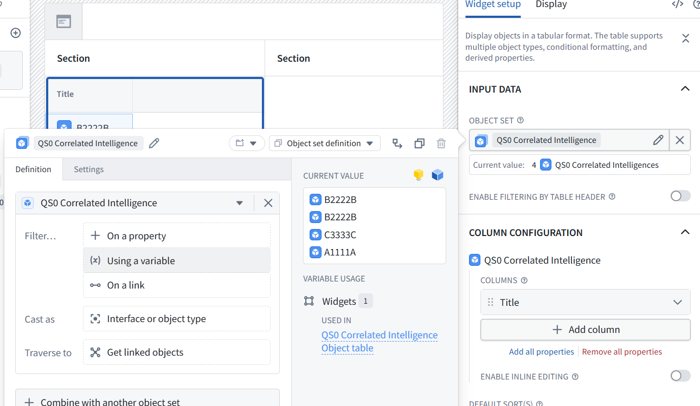
