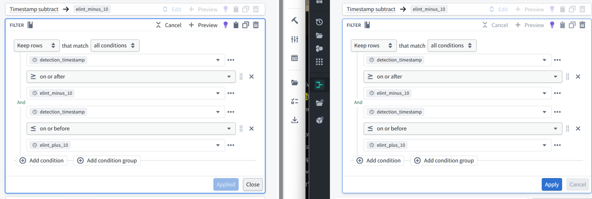
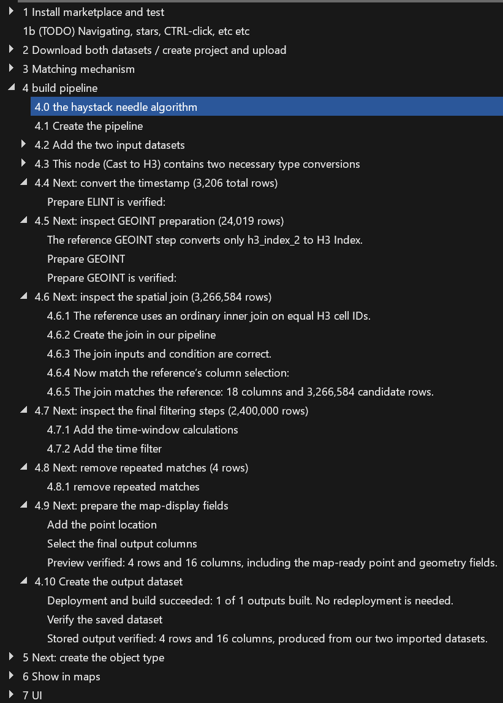
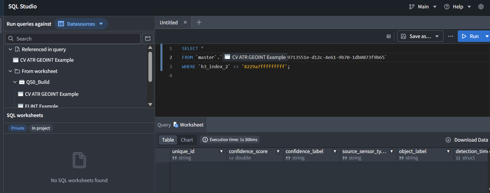
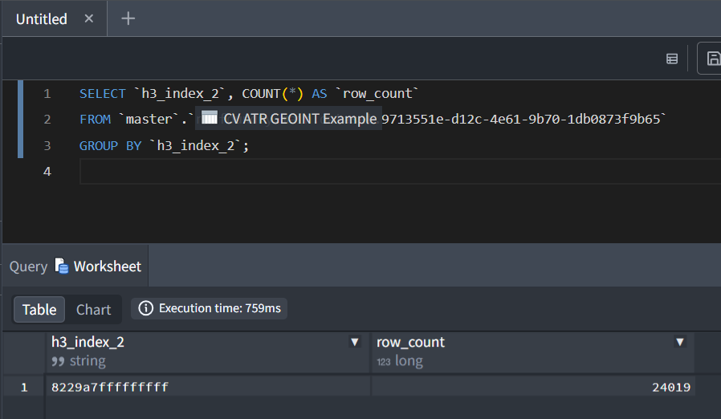

<br>

<!-- 8 HN algorithm description -->
[← 7 Create UI](/pal_qs0_7_ui/) / [↑ 3.2 Foundry QS0](/pal_qs0/)

_Converted 2026-11-19 04:47 PM EST_


<br>

**TOC**
- [8.0a CHAT: Matching mechanism](#section-8-0a-chat-matching-mechanism)
  - [FDE: Next we should explain the matching mechanism before creating the pipeline:](#section-fde-next-we-should-explain-the-matching-mechanism-before-creating-the-pipeline)
  - [FDE: Yes—the pictured filter is one of the key places where candidate matches are narrowed down](#section-fde-yes-the-pictured-filter-is-one-of-the-key-places-where-candidate-matches-are-narrowed-down)
  - [Does Spark parallelize this?](#section-does-spark-parallelize-this)
  - [ME: sounds good... thats enough... no reason to get into a lot of details...](#section-me-sounds-good-thats-enough-no-reason-to-get-into-a-lot-of-details)
- [8.0b ME: section 4.0 "the hackstack needle (HN)" algorithm.](#section-8-0b-me-section-4-0-the-hackstack-needle-hn-algorithm)
- [8.1 What are ELINT and GEOINT?](#section-8-1-what-are-elint-and-geoint)
- [8.2 How thousands of records become millions of candidate pairs](#section-8-2-how-thousands-of-records-become-millions-of-candidate-pairs)
- [8.3 How we reduce the candidates to four results](#section-8-3-how-we-reduce-the-candidates-to-four-results)
- [8.3b  one example of a calculation that yields a pair](#section-8-3b-one-example-of-a-calculation-that-yields-a-pair)
- [8.3c drop duplicates](#section-8-3c-drop-duplicates)
- [8.3d so the algorithm is simply (for 77,004,914 pairs) (THATS WHAT I WANTED)](#section-8-3d-so-the-algorithm-is-simply-for-77-004-914-pairs-thats-what-i-wanted)
- [8.3e why only 3 million (not 75 million) (silly question)](#section-8-3e-why-only-3-million-not-75-million-silly-question)
- [8.4 How Spark processes the data](#section-8-4-how-spark-processes-the-data)
- [8.5 The same pattern outside intelligence](#section-8-5-the-same-pattern-outside-intelligence)

<br>

<a id="section-8-0a-chat-matching-mechanism"></a>
### **8.0a CHAT: Matching mechanism**

<br>

<a id="section-fde-next-we-should-explain-the-matching-mechanism-before-creating-the-pipeline"></a>
#### **FDE: Next we should explain the matching mechanism before creating the pipeline:**

what counts as a candidate spatial match, how the time-window filter narrows it, and which final checks produce the needles. We’ll inspect the original **Correlate Intelligence (Pipeline Builder)** as a reference—without changing it—so we reproduce its actual rules rather than guess.

<br>

<a id="section-me-very-good-idea-the-target-read-knows-like-me-basically-nothing-data-science"></a>
**ME: very good idea.... the target read knows (like me) basically nothing data science.**

explain the core point where the needle search happens..

i believe its the attached pic.

and that this will use spark to do parallel processing on CPUs

(just like use CUDA to do on GPUs)...

if that is accurate.

<br>

<a id="section-fde-yes-the-pictured-filter-is-one-of-the-key-places-where-candidate-matches-are-narrowed-down"></a>
#### **FDE: Yes—the pictured filter is one of the key places where candidate matches are narrowed down**



It applies a time-window test:

**Keep a detection only if its timestamp falls between elint_minus_10 and elint_plus_10, including the boundaries.**

We must inspect the preceding timestamp calculations to confirm the **unit**—the names alone do not tell us whether “10” means minutes, seconds, or something else.

<br>

<a id="section-where-the-needle-search-happens"></a>
**Where the needle search happens**

<br>

<a id="section-the-search-is-the-combined-sequence-of-operations-not-necessarily-this-filter-alone"></a>
**The search is the combined sequence of operations, not necessarily this filter alone:**

<br>

<a id="section-1-spatial-matching-identify-candidate-pairs-of-observations-in-the-same-area"></a>
**1 Spatial matching: identify candidate pairs of observations in the same area.**

<br>

<a id="section-2-time-filtering-the-pictured-step-retain-pairs-close-enough-in-time"></a>
**2 Time filtering—the pictured step: retain pairs close enough in time.**

<br>

<a id="section-3-any-further-checks-narrow-the-candidates-to-the-final-results"></a>
**3 Any further checks: narrow the candidates to the final results.**

<br>

<a id="section-an-analogy-for-beginners"></a>
**An analogy for beginners:**

**First find observations from approximately the same place. Then ask whether they happened at approximately the same time. Keep the pairs that satisfy both tests.**

We’ll verify the original pipeline’s exact operations before presenting that as its full matching rule.

<br>

<a id="section-does-spark-parallelize-this"></a>
#### **Does Spark parallelize this?**

<br>

<a id="section-if-this-pipeline-runs-on-spark-yes"></a>
**If this pipeline runs on Spark, yes:**

Spark can evaluate the filter across data partitions in parallel on CPU workers. We should verify the pipeline’s execution configuration before labeling it specifically Spark.

<br>

<a id="section-your-cuda-comparison-works-at-the-broad-conceptual-level"></a>
**Your CUDA comparison works at the broad conceptual level:**

**Express the operation once; let the execution system apply it across many records in parallel.**

Spark distributes tasks across partitions and workers; CUDA executes kernels across GPU threads. They are different technologies, but **parallelizing repetitive computation** is the common idea.

<br>

<a id="section-the-filter-finds-matches-using-explicit-rules-no-ai-or-data-science-knowledge-is-required-to-understand-this-step"></a>
**The filter finds matches using explicit rules. No AI or data-science knowledge is required to understand this step.**

<br>

<a id="section-me-sounds-good-thats-enough-no-reason-to-get-into-a-lot-of-details"></a>
#### **ME: sounds good... thats enough... no reason to get into a lot of details...**

reader wont undrestand until has done the demo.

so have a summary/review after its done.

**Agreed.** Before the build, just give the reader the purpose:

**We’ll find observations that occurred near the same place and time, save the matches, and display them on a map.**

Then **build → preview → verify**, explaining each setting when it is used.

Afterward, the summary will connect the steps: **where matching happened, how each operation narrowed the candidates, and how the results reached the map.**

<br>

<a id="section-8-0b-me-section-4-0-the-hackstack-needle-hn-algorithm"></a>
### **8.0b ME: section 4.0 "the hackstack needle (HN)" algorithm.**

the idea is to

```

(1)- explain ELINT and GEOINT data.

(2)- how we went from 3000 rows and 24000 rows in 4.4 and 4.5

(3)- to 4 rows in 4.8 (at the end)

(4)- also explain maybe spark... how these searches are done quickly

(5)- finally, this is sigint... but how HN algorithm can be used in other industries

```



FDE: Our goal is to find observations that match **in location and time**, then display the results.

“Haystack–needle” is our teaching label for this workflow—not the name of a specific Foundry algorithm.

<br>

<a id="section-8-1-what-are-elint-and-geoint"></a>
### **8.1 What are ELINT and GEOINT?**

The example supplies two datasets:

- **ELINT—electronic intelligence:** observations of electronic emissions, with timestamps, locations, track identifiers, and estimated location shapes.

- **GEOINT—geospatial intelligence:** in this example, computer-vision detections with locations, detection timestamps, object labels such as ground_vehicle, and confidence values.

**The question:** which electronic observations have computer-vision detections in the same broad area and within a specified time window?

We use the supplied example data; we do not assume it represents real operational observations.

<br>

<a id="section-8-2-how-thousands-of-records-become-millions-of-candidate-pairs"></a>
### **8.2 How thousands of records become millions of candidate pairs**

Our inputs contain:

| Input dataset | Rows |
| --- | --- |
| ELINT Example | 3,206 |
| CV ATR GEOINT Example | 24,019 |

Each record includes an **H3 cell ID**. H3 divides the world into geographic cells; matching cell IDs identify observations in the same cell.

We join records with equal H3 IDs.

**One ELINT record can match many GEOINT records, and vice versa.** The join therefore produces **3,266,584 candidate pairs**—more rows than either input.

These are possible matches, not yet four final needles. Sharing a coarse cell does not prove that two observations describe the same physical object.

FDE: The H3 cell ID is in the column named **h3_index_2**:

- **ELINT:** second column from the right.

- **GEOINT:** rightmost column.

Values such as 825b17fffffffff are H3 cell IDs. They are encoded identifiers, not latitude/longitude coordinates.

Both datasets already contain these IDs. Our **Logical type cast → H3 Index** tells Foundry how to interpret them; our join then matches records whose **h3_index_2 values are equal**.

<br>

<a id="section-fde-yes-the-displayed-geoint-rows-all-have-the-same-h3-index-2-value-we-haven-t-checked-whether-that-is-true-for-all-24-019-rows"></a>
**FDE: Yes—the displayed GEOINT rows all have the same h3_index_2 value. We haven’t checked whether that is true for all 24,019 rows.**

That is possible because **H3 cells at resolution 2 cover large areas**. Many detections at different coordinates can share one cell ID.

This explains why the join produces so many candidate pairs: **it matches the same broad cell, not the same exact location**.

We should clarify that in the tutorial—and verify the number of distinct H3 IDs before claiming they are all identical.

```

8229a7fffffffff

SELECT *

FROM `master`.`ri.foundry.main.dataset.9713551e-d12c-4e61-9b70-1db0873f9b65`

WHERE `h3_index_2` <> '8229a7fffffffff';

```



**The query returned no rows:** no non-null H3 ID differs from 8229a7fffffffff.

To check every value, including nulls, keep your existing **FROM** line and run:

```

SELECT `h3_index_2`, COUNT(*) AS `row_count`

FROM /* keep your existing dataset reference here */

GROUP BY `h3_index_2`;

```

If it returns **one row with count 24,019**, then every GEOINT record has that same H3 ID.



<br>

<a id="section-fde-as-a-beginner-tutorial-it-has-significant-weaknesses-yes-what-we-ve-verified-supports-that-criticism"></a>
**FDE: As a beginner tutorial, it has significant weaknesses—yes. What we’ve verified supports that criticism:**

- **Misleading naming:** elint_plus_10 actually adds **one day**.

- **Very coarse spatial matching:** all GEOINT rows share one H3 cell, producing millions of candidate pairs.

- **Arbitrary result selection:** dropping duplicates retains one detection without defining which is preferable.

- **Insufficient explanation:** the distinction between candidate pairs and the four consolidated results is easy to miss.

**A coarse H3 join is not inherently wrong**—it can be a useful first-stage filter. But without a finer spatial test, we should not present these results as precise correlations or confirmed “needles.”

I would describe it as **a geospatial tooling demonstration, not a rigorous detection algorithm**. Your tutorial can make that limitation explicit while still using it to teach importing, joins, filters, Ontology, and maps.

<br>

<a id="section-8-3-how-we-reduce-the-candidates-to-four-results"></a>
### **8.3 How we reduce the candidates to four results**

| Stage | Rule | Result |
| --- | --- | --- |
| Match H3 cells | Pair observations with equal H3 cell IDs | 3,266,584 candidate pairs |
| Filter by time | Keep detections from 10 minutes before through 1 day after the ELINT timestamp | 2,419,560 pairs |
| Remove repeated matches | Keep one row per unique ELINT geometry + Track Id combination | 4 rows |

**An important distinction:** the time filter does not reduce millions of pairs directly to four. The final reduction comes from grouping repeated matches by the selected keys and retaining one representative.

The reference’s **Drop duplicates** operation keeps an arbitrary representative. Consequently, a retained detection’s timestamp or confidence may differ between runs. The four results are **four unique key combinations with qualifying matches**, not proof of four confirmed real-world targets.

<br>

<a id="section-8-3b-one-example-of-a-calculation-that-yields-a-pair"></a>
### **8.3b  one example of a calculation that yields a pair**

Yes—take **one ELINT observation and one GEOINT detection from our results**.

<br>

<a id="section-1-their-h3-ids-match"></a>
**1. Their H3 IDs match**

```

ELINT H3 ID:   8229a7fffffffff

GEOINT H3 ID:  8229a7fffffffff

```

The join therefore creates a **candidate pair** containing both records.

<br>

<a id="section-2-calculate-the-elint-time-window"></a>
**2. Calculate the ELINT time window**

```

The ELINT timestamp is:

June 27, 2024 at 08:16:14 UTC

Our calculations produce:

Lower boundary: June 27 at 08:06:14 UTC  (subtract 10 minutes)

Upper boundary: June 28 at 08:16:14 UTC  (add 1 day)

```

<br>

<a id="section-3-test-the-geoint-detection"></a>
**3. Test the GEOINT detection**

```

The paired GEOINT detection timestamp is:

June 27, 2024 at 17:30:47.524 UTC

```

| Filter condition | Result |
| --- | --- |
| Detection ≥ June 27 at 08:06:14 | True |
| Detection ≤ June 28 at 08:16:14 | True |

<br>

<a id="section-both-conditions-pass-so-the-pair-survives-the-time-filter"></a>
**Both conditions pass, so the pair survives the time filter.**

This establishes **same coarse H3 cell + inside the configured time window**—not necessarily the same physical object.

<br>

<a id="section-8-3c-drop-duplicates"></a>
### **8.3c drop duplicates**

we drop duplicates for For **Column subset**, select only:

  - elint_geometry

  - track_id

ME: i assume both of these values are in both datasets? can you give examples of these values, what they mean?

**FDE:** **No—both columns come from the ELINT dataset.** The join carries them into each candidate pair alongside the GEOINT fields.

| Column | Example | Meaning |
| --- | --- | --- |
| track_id | d5973b87-ff5e-4d76-99f2-eccdfe1bd59e | Identifies an ELINT track. Multiple observations can belong to the same track. |
| elint_geometry | {"type":"Polygon","coordinates":[…]} | A GeoJSON polygon describing the ELINT observation’s geographic area. The … here abbreviates the actual coordinate list. |

**What “drop duplicates” means here**

It compares the **combination of those two values**:

(elint_geometry, track_id)

For example, suppose these joined rows survived the time filter:

| ELINT Track Id | ELINT geometry | Paired GEOINT detection |
| --- | --- | --- |
| Track A | Polygon X | Detection 1 |
| Track A | Polygon X | Detection 2 |
| Track A | Polygon X | Detection 3 |

**Drop duplicates keeps one arbitrary row**, because all three share the same **Track A + Polygon X** combination.

It does **not** require their GEOINT detection IDs, timestamps, or confidence values to match.

So the four final rows mean:

**Four distinct ELINT track-and-geometry combinations had at least one qualifying GEOINT match. We retain one representative pair for each combination.**

ME: match = h3_index_2 in both are the same

**Yes—the join’s “match” means only:**

ELINT.h3_index_2 = GEOINT.h3_index_2

The **time filter** then checks whether that pair’s timestamps fall within the configured window.

Neither step compares **elint_geometry** with the GEOINT detection’s exact location.

<br>

<a id="section-8-3d-so-the-algorithm-is-simply-for-77-004-914-pairs-thats-what-i-wanted"></a>
### **8.3d so the algorithm is simply (for 77,004,914 pairs) (THATS WHAT I WANTED)**

```

filter1:only entries with (ELINT h3_index_2 = ELINT h3_index_2).

filter2: only a single combination of ([ELINT trackid] ,  [ELINT Geometry])

```

**Almost—you’re missing the time filter, and the first comparison is ELINT versus GEOINT.**

The algorithm is:

<br>

<a id="section-4-6-join-3-266-584-create-pairs-where-elint-h3-index-2-geoint-h3-index-2"></a>
**(4.6) Join (=3,266,584): create pairs where  ELINT.h3_index_2 = GEOINT.h3_index_2.**

<br>

<a id="section-4-7-time-filter-2-419-560-keep-pairs-where-the-geoint-detection-occurred-between-10-minutes-before-and-1-day-after-the-elint-timestamp"></a>
**(4.7) Time filter (=2,419,560): keep pairs where the GEOINT detection occurred between 10 minutes before and 1 day after the ELINT timestamp.**

<br>

<a id="section-4-8-deduplicate-4-keep-one-arbitrary-surviving-pair-per-distinct-combination-of-elint-track-id-elint-elint-geometry"></a>
**(4.8) Deduplicate (=4): keep one arbitrary surviving pair per distinct combination of (ELINT.track_id, ELINT.elint_geometry).**

Step 3 does not keep just one combination overall—it keeps one row **for each combination**, yielding four rows in this example.

**Exactly** **🙂** **That three-step description is the core algorithm.** The type conversions and map-field preparation support it; they are not additional matching rules.

<br>

<a id="section-8-3e-why-only-3-million-not-75-million-silly-question"></a>
### **8.3e why only 3 million (not 75 million) (silly question)**

<br>

<a id="section-in-4-4-there-are-3200-in-4-5-24-000-so-why-only-3million-spatial-joins-not-75-million"></a>
**in 4.4 there are 3200, in 4.5 24,000 so why only ~3million spatial joins, not 75 million?**

**Because the join pairs only records with equal H3 IDs—not every ELINT record with every GEOINT record.**

All **24,019 GEOINT records** have H3 ID 8229a7fffffffff, but only **136 of the 3,206 ELINT records** have that ID.

Therefore:

136 × 24,019 = 3,266,584 candidate pairs

Pairing **every record with every record** would instead produce:

3,206 × 24,019 = 77,004,914 pairs

The remaining **3,070 ELINT records** have different H3 IDs, so they contribute **no pairs** to this inner join.

<br>

<a id="section-8-4-how-spark-processes-the-data"></a>
### **8.4 How Spark processes the data**

We selected **Standard batch compute**, which is backed by **Spark**.

Rather than writing a loop that manually checks records one by one, we configure operations such as **join**, **filter**, and **drop duplicates**. Spark plans their execution and can distribute work across data partitions and available CPU workers.

**Parallel processing helps with large collections, but speed also depends on data size, join structure, available compute, and startup overhead.** Our small exercise demonstrates the mechanism—not a performance benchmark.

<br>

<a id="section-8-5-the-same-pattern-outside-intelligence"></a>
### **8.5 The same pattern outside intelligence**

ELINT is part of signals intelligence; this example combines it with geospatial detections. But **matching records by shared attributes, location, and time is broadly useful**:

| Industry | Possible “needle” |
| --- | --- |
| Manufacturing | A defect associated with machine readings near its production time |
| Logistics | A delivery scan associated with a vehicle near the delivery location |
| Energy | An equipment alarm associated with nearby inspection observations |
| Retail | A stock discrepancy associated with relevant inventory movements |

The reusable pattern is:

**Define a match → generate candidate pairs → apply additional conditions → consolidate results → inspect them.**

We’ll now build each step. After completing the pipeline and map, return to this summary and connect each operation to the result you observed.
